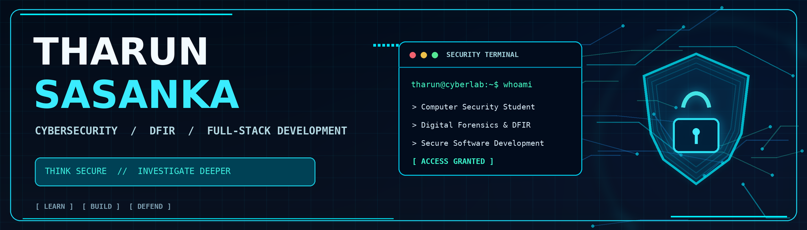
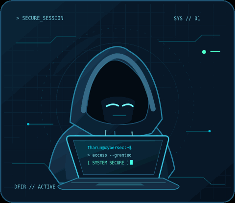
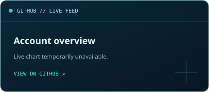
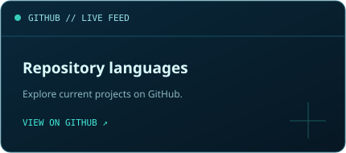
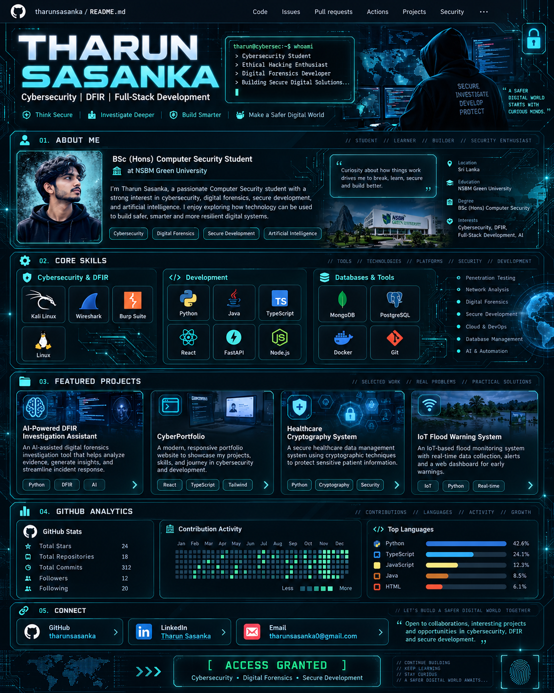

<div align="center">

<!-- The artwork is stored in this repository so the hero is not dependent on a banner generator. -->


<br />


<br />

<a href="https://github.com/tharunsasanka"></a>
<a href="https://github.com/tharunsasanka?tab=followers"></a>
<a href="https://tharunsasanka.github.io/tharunsasanka/"></a>

<sub>⚡ THINK SECURE &nbsp; • &nbsp; INVESTIGATE DEEPER &nbsp; • &nbsp; BUILD SMARTER</sub>

</div>

---

<table>
<tr>
<td valign="top" width="54%">

<h3><code>&gt; INITIALIZING PROFILE...</code></h3>

<pre>┌─[tharun@cyberlab]─[~]
└──╼ $ whoami

Name       : Tharun Sasanka
Role       : Computer Security Student
University : NSBM Green University
Location   : Sri Lanka
Focus      : Cybersecurity / DFIR
             Secure Development / AI
Status     : [ ACCESS GRANTED ]</pre>

<p>I'm a <strong>BSc (Hons) Computer Security student</strong> interested in understanding how digital systems work, investigating what can go wrong, and developing solutions that are secure by design.</p>

<p>Currently focused on <strong>digital forensics and incident response</strong>, <strong>web application security</strong>, and building meaningful <strong>full-stack applications</strong>.</p>

</td>
<td valign="middle" align="center" width="46%">



<sub>ANIMATED HACKER // LOCAL GIF ASSET</sub>

</td>
</tr>
</table>

## 🛡️ `01 // ABOUT ME`

```yaml
student: BSc (Hons) Computer Security
university: NSBM Green University
interests:
  - Digital Forensics & Incident Response
  - Ethical Hacking & Web Security
  - Secure Full-Stack Development
  - Artificial Intelligence
learning: [TryHackMe, Hack The Box, University Labs]
mindset: "Explore. Investigate. Build. Secure."
```

> **`[ SECURITY PRINCIPLE ]`** Learn continuously. Question assumptions. Build with security in mind.

---

## ⚙️ `02 // CYBER ARSENAL`

<details open>
<summary><strong>🔎 Cybersecurity / DFIR</strong></summary>
<br />
<p>


</p>
</details>

<details open>
<summary><strong>💻 Development / Engineering</strong></summary>
<br />
<p></p>
</details>

<details open>
<summary><strong>🗄️ Databases / Dev Tools</strong></summary>
<br />
<p></p>
</details>

---

## 🧬 `03 // PROJECT FILES`

<table>
<tr><td width="50%" valign="top">

<h3><code>01</code> • AI-Powered DFIR Investigation Assistant</h3>

<strong>Digital Forensics / Incident Response / AI</strong>

<p>A digital-forensics investigation concept with evidence management, timeline generation, suspicious-activity detection, MITRE ATT&amp;CK mapping and AI-assisted reporting.</p>

  

</td><td width="50%" valign="top">

<h3><code>02</code> • CyberPortfolio</h3>

<strong>Full Stack / UI-UX / Security</strong>

<p>An interactive cybersecurity portfolio concept featuring an administrator area, project and certificate management, animated components, and a contact inbox.</p>

  

</td></tr>
<tr><td width="50%" valign="top">

<h3><code>03</code> • Healthcare Cryptography System</h3>

<strong>Cryptography / Authentication / Data Protection</strong>

<p>A healthcare application concept exploring role-based access control, JWT authentication, medical-record management and AES encryption analysis.</p>

  

</td><td width="50%" valign="top">

<h3><code>04</code> • IoT Flood Warning System</h3>

<strong>ESP32 / Sensors / Cloud Alerts</strong>

<p>An ESP32-based environmental monitoring concept using water-level, rain, soil-moisture and weather sensors with cloud-connected warnings.</p>

  

</td></tr>
</table>

<div align="center">
<a href="https://github.com/tharunsasanka?tab=repositories"></a>
</div>

---

## 📊 `04 // REPOSITORY TELEMETRY`

<div align="center">


<br /><br />

<br />
<sub>Statistics are live third-party images and may occasionally be delayed or unavailable; no invented numbers are used here.</sub>
</div>

---

## 🧿 `05 // VISUAL BLUEPRINT`

The **asset artwork** is included in this repository and appears in the [interactive site](https://tharunsasanka.github.io/tharunsasanka/) as part of the design gallery.

<details>
<summary><strong>Expand the original cybersecurity portfolio concept image</strong></summary>
<br />
<div align="center"></div>
<br />
<sub>This is concept artwork; any statistics shown inside the illustration are mock data, not the actual account metrics.</sub>
</details>

---

## 📡 `06 // CONNECT`

<div align="center">
<a href="https://github.com/tharunsasanka"></a>
<a href="https://www.linkedin.com/in/tharun-sasanka-8280ba2b4/"></a>
<a href="mailto:tharunsasanka0@gmail.com"></a>

<br /><br />

```text
╔══════════════════════════════════════════╗
║            [ ACCESS GRANTED ]            ║
║  SECURE  //  INVESTIGATE  //  BUILD      ║
╚══════════════════════════════════════════╝
```

<sub>Made to keep learning, exploring and building safer technology.</sub>

</div>

---

<details>
<summary>🛠️ <strong>How this profile README and the live site work</strong></summary>
<br />

- **GitHub profile README:** This file displays in the repository named exactly `tharunsasanka`, under the account `tharunsasanka`.
- **Animated illustration:** `assets/hacker-typing.gif` loops directly inside the README. GitHub READMEs do not run page JavaScript.
- **Live portfolio page:** `index.html`, `styles.css` and `script.js` produce the responsive website, including a smoother animated SVG at `assets/hacker-animated.svg`.
- **Publish with GitHub Pages:** Repository **Settings → Pages → Build and deployment → Deploy from a branch → main → /(root) → Save**. Once deployed, the site is expected at `https://tharunsasanka.github.io/tharunsasanka/` (assuming the repository is named `tharunsasanka`).
- Keep the **`assets/` folder** next to `README.md` and `index.html`. Otherwise the local pictures will not appear.
- Dynamic badges and GitHub statistics use external services and may be temporarily unavailable.

</details>
